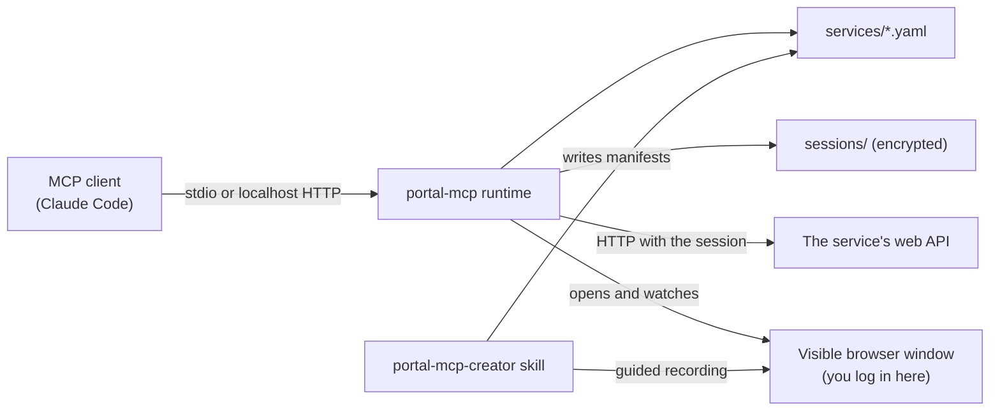
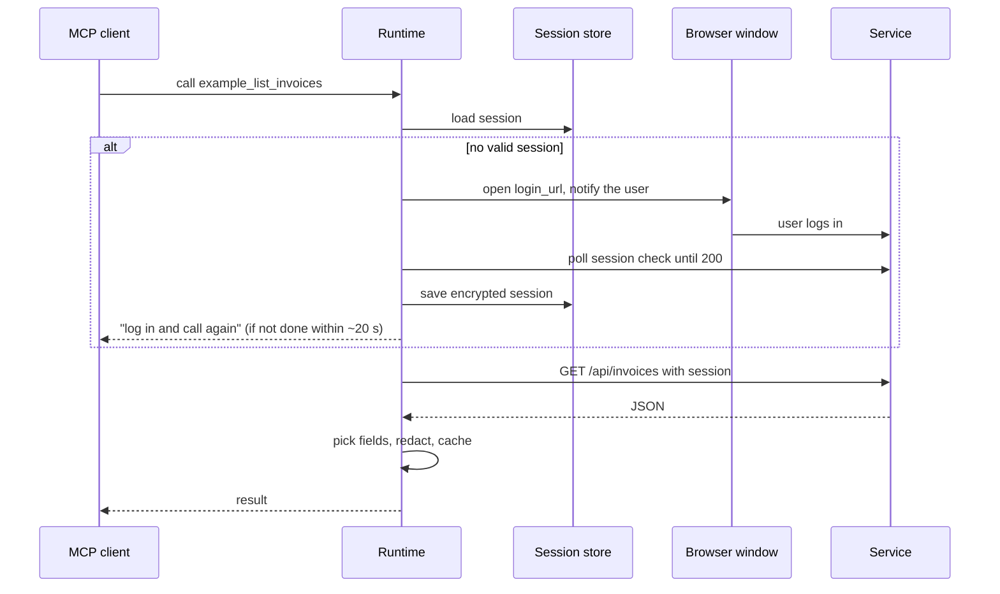
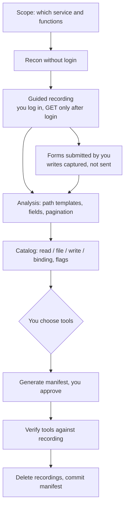
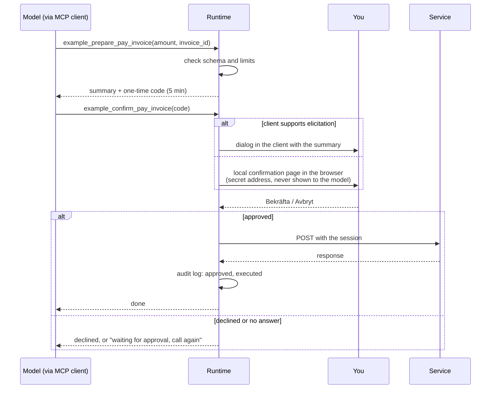

# portal-mcp

[](https://github.com/markstrom/portal-mcp/releases)
[](pyproject.toml)
[](https://modelcontextprotocol.io)
[](LICENSE)
[](#install)

**Turn any website or customer portal into MCP tools, without an open API and without writing code.** portal-mcp is a Claude Code plugin and a local MCP server. You point it at a site, log in yourself if the site needs it, and the plugin explores the pages in a real browser, learns how they load their data, and lets you choose which tools Claude gets: list your invoices, download a PDF, look something up, fill in a form.

- Works with logged-in services, customer portals and public sites.
- You log in yourself, in a visible browser window. The runtime never reads or stores your password.
- Each service is described by a YAML manifest. The runtime turns the manifest into MCP tools.
- Sessions are stored encrypted. The encryption key lives in your system keyring.
- Write actions run in two steps and only after you approve them yourself, in a dialog or a local confirmation page. The model cannot approve its own actions.
- Every write action is logged in a local audit log.

**Status: version 0.9.1.** Runtime with read, file, write and binding tools and human approval; logins through other hosts, BankID and OpenID Connect apps; public sites without login; encrypted sessions and several profiles per service; a recorder that explores pages by itself and captures writes without sending them; `self_test`, desktop notifications, the `portal-mcp-creator` skill and the slash commands. Tested against a local mock service.

## Requirements

- A computer with a graphical desktop: macOS, Windows, or Linux with a desktop environment.
- [`uv`](https://docs.astral.sh/uv/) to run the runtime.
- Google Chrome (preferred), or Playwright's Chromium: `uv run playwright install chromium`.

## Install

Pick the way that matches where you use Claude. Everything except the last option installs the whole plugin: the runtime, the `portal-mcp-creator` skill and the `/portal-mcp:*` commands.

| Where you use Claude | Way to install |
|---|---|
| Claude Code in a terminal | [Slash commands](#claude-code-in-a-terminal) or [the command line](#the-command-line) |
| The Claude desktop app, Code tab | [The command line](#the-command-line) or [the app's plugin settings](#the-claude-desktop-app-code-tab) |
| Claude Code in VS Code or JetBrains | [The command line](#the-command-line) |
| A team or a project | [Project settings](#a-team-or-a-project) |
| Working on the plugin itself | [A local clone](#a-local-clone-for-development) |
| Another MCP client, or the desktop app's chat | [The runtime alone](#the-runtime-alone-as-an-mcp-server) (tools only) |

While the repository is private, every way fetches it with your local git credentials, so only accounts with access can install it. With the GitHub CLI: `gh auth login`, then `gh auth setup-git`.

### Claude Code in a terminal

```text
/plugin marketplace add markstrom/portal-mcp
/plugin install portal-mcp@portal-mcp
```

`/plugin` opens an interactive dialog, so it works only in Claude Code in a terminal.

### The command line

Run these in any terminal. Claude Code in a terminal, the desktop app and the IDE extensions share the same installation, so this works for all of them:

```bash
claude plugin marketplace add markstrom/portal-mcp
claude plugin install portal-mcp@portal-mcp
```

Restart the app or Claude Code afterwards so the plugin is loaded.

### The Claude desktop app, Code tab

The Code tab cannot run `/plugin`. Either use [the command line](#the-command-line) and restart the app, or add the marketplace `markstrom/portal-mcp` in the app's plugin settings and install `portal-mcp` from there.

### A team or a project

Add this to `.claude/settings.json` in a project. Everyone who opens the project in Claude Code and trusts it is offered the plugin:

```json
{
  "extraKnownMarketplaces": {
    "portal-mcp": { "source": { "source": "github", "repo": "markstrom/portal-mcp" } }
  },
  "enabledPlugins": { "portal-mcp@portal-mcp": true }
}
```

### A local clone, for development

```bash
git clone https://github.com/markstrom/portal-mcp.git
claude plugin marketplace add ./portal-mcp
claude plugin install portal-mcp@portal-mcp
```

Or load it for one session only, without installing: `claude --plugin-dir ./portal-mcp`.

### The runtime alone, as an MCP server

Other MCP clients can use the runtime directly. You then get the tools of the services you have already added, but not the skill or the `/portal-mcp:*` commands, so new services are added from Claude Code. Clone the repository first, then point the client at it.

For Claude Code without the plugin:

```bash
claude mcp add portal-mcp -- uv run --quiet --project /path/to/portal-mcp portal-mcp-runtime
```

For the Claude desktop app's chat, or any client that reads an `mcpServers` file (in the desktop app: Settings, Developer, Edit config):

```json
{
  "mcpServers": {
    "portal-mcp": {
      "command": "uv",
      "args": ["run", "--quiet", "--project", "/path/to/portal-mcp", "portal-mcp-runtime"]
    }
  }
}
```

Clients that connect over HTTP can use `uv run portal-mcp-runtime --http` and the address `http://127.0.0.1:8765/mcp` instead.

### Check, update and remove

- Check: `/portal-mcp:list` shows the loaded services. If the tools do not show up, restart the app or Claude Code.
- Update: `claude plugin update portal-mcp@portal-mcp`, then restart. In a terminal session, `/plugin` has the same option.
- Remove: `claude plugin uninstall portal-mcp@portal-mcp` and `claude plugin marketplace remove portal-mcp`. Your services, sessions and downloads stay in the data directory (see [Where your data lives](#where-your-data-lives)) until you delete them.

## Commands

| Command | What it does |
|---|---|
| `/portal-mcp:add <url>` | Add a service, logged in or public. It starts at once: you log in if the service needs it, the plugin visits and explores the pages itself, then shows a catalog where you choose the tools. |
| `/portal-mcp:update <service>` | Explore more parts of a service, or redo discovery for tools that stopped working. |
| `/portal-mcp:list` | Services, profiles, tools and session status. |
| `/portal-mcp:test <service> [profile]` | Run `self_test` and suggest an update if answers changed. |
| `/portal-mcp:logout <service> [profile]` | Log out at the service and delete the local session. |

## How it fits together



The skill creates manifests. The runtime turns them into tools. The browser is only used for logging in and recording, and you control the login.

Public sites work too: with `session: {type: none}` there is no login, no session and nothing stored, and tools call the site without cookies. If a site has both public pages and a login, `/portal-mcp:add` asks once which part you want. For public sites the site's terms and `robots.txt` apply; the skill leaves disallowed paths out and suggests a low rate limit.

While recording, the plugin explores each page itself: it clicks tabs, expandable sections and "show more" buttons, because many single-page apps load their data only after such a click. It never clicks controls that mean an action (log out, delete, pay, send, save, confirm and similar), submit buttons, unlabeled controls or downloads, and every write a click causes is blocked and captured, never sent.

## Login and a tool call



## Creating a service (skill pipeline)



## Write actions and approval



The summary you approve is built by the runtime from the real values, not written by the model. Codes are one-time and expire after five minutes. Limits are checked when the action is prepared and again when it is confirmed.

## Where your data lives

Data is kept outside the plugin, so updates never remove it. The location follows your OS conventions (`platformdirs`):

```text
<user data dir>/portal-mcp/
  services/<service>.yaml     manifests
  services/<service>.schemas.json  self_test baselines (structure only)
  profiles/<service>/<profile>/  browser profiles
  sessions/                   encrypted sessions
  recordings/                 temporary recordings, deleted after a manifest is written
  audit.log                   every write action: time, service, tool, call and response
```

Set `PORTAL_MCP_HOME` to use another base directory. Downloaded files go to your Downloads folder, or to `PORTAL_MCP_DOWNLOADS` if set.

## Manifest

One file per service, `services/<name>.yaml`. The file name must match `name`. A broken manifest only affects its own service.

The runtime watches `services/` and sends `tools/list_changed` when a manifest changes. Some clients still need a restart before new or changed tools show up.

```yaml
name: example
enabled: true
base_url: https://app.example.com
login_url: https://app.example.com/login
profiles: [default]
session:
  type: cookies               # cookies | bearer
  bearer_source: null         # for bearer: "localStorage:<key>" or "sessionStorage:<key>"
  csrf:
    header: x-csrf-token
    from_cookie: csrf
  check: /api/session         # 200 = logged in, 401 = not logged in
  logout: /api/logout         # optional, called with POST
login_hosts: [login.example.com]  # optional: other hosts the login goes through
data_hosts: [api.example.net]     # optional: APIs on other hosts the pages load data from
asset_hosts: [cdn.example.net]    # optional: CDNs for scripts, styles, fonts and images
login_hosts_after_login: blocked  # or oidc: login host open after login for OIDC endpoints only
rate_limit_per_minute: 30
cache_seconds: 30             # caches read results
redact: [items.owner.national_id]
tools:
  - name: list_invoices
    kind: read                # read | file | write | binding
    description: List invoices with date, amount and status.
    method: GET
    path: /api/invoices
    params:
      type: object
      properties:
        page: {type: integer}
    pick: [items.id, items.date, items.amount, items.status]
  - name: download_invoice_pdf
    kind: file
    description: Download the PDF for one invoice.
    method: GET
    path: /api/invoices/{invoice_id}/pdf
    params:
      type: object
      properties:
        invoice_id: {type: string}
      required: [invoice_id]
  - name: pay_invoice
    kind: binding             # binding: payments, bids, orders, signatures
    description: Pay an invoice.
    method: POST
    path: /api/invoices/{invoice_id}/pay
    params:
      type: object
      properties:
        invoice_id: {type: string}
      required: [invoice_id]
    body_encoding: json       # json | form
    body_schema:
      type: object
      properties:
        amount: {type: number}
      required: [amount]
    body_constants: {}        # fixed body fields, for example hidden form inputs
    limits:                   # required for binding tools
      max: {amount: 5000}     # also: min, allowed (list of values), max_length
    summary: "Pay {amount} for invoice {invoice_id}"
  - name: send_message
    kind: write
    messaging: true           # sends free text to other people: off by default
    enabled: true             # needed to turn a messaging tool on
    method: POST
    path: /api/messages
    body_schema:
      type: object
      properties:
        to: {type: string}
        text: {type: string}
      required: [to, text]
```

Read and file tools are prefixed with the service name, for example `example_list_invoices`. Write and binding tools become `example_prepare_pay_invoice` and `example_confirm_pay_invoice`. Every tool except `confirm_` also takes an optional `profile` argument.

Common tools:

- `list_services`: services, profiles, session status, tools, hidden tools, load errors and the data paths.
- `forget_session(service, profile?)`: delete the local session without contacting the service.
- `logout(service, profile?)`: call the logout endpoint and delete the local session; without a profile, all profiles.
- `self_test(service, profile?, update_baseline?)`: run the read tools and compare each answer's structure with the saved baseline.

### Self test

`self_test` runs every exposed read tool. Tools with required parameters need `test_args` in the manifest, for example `test_args: {page: 1}`; without them they are skipped. Write and file tools are never run.

The first run saves the structure of each answer (field names and types, never values) in `services/<service>.schemas.json`. Later runs report removed or changed fields as `changed`, and new fields as notes. Run it with `update_baseline: true` to accept a new structure.

### Profiles

A service can have several profiles, for example two people in a household or a private and a business account: `profiles: [default, business]`. Each profile has its own browser profile and its own encrypted session. Every tool takes an optional `profile` argument; the first call with a new profile opens a login window for it.

### Notifications

The runtime shows a desktop notification when a login is waiting, when a login is done, and when a confirmation page is waiting for you. macOS uses `osascript`, Linux uses `notify-send` when it is installed, and Windows uses `desktop-notifier`. Set `PORTAL_MCP_NO_NOTIFY=1` to turn them off.

### Logging in

When the creator skill records a service, every recording starts with a clean, temporary browser profile, checks that the login is really verified (only a 200 from `session.check` counts, and a check that answers 200 without a login is refused), and only then lists the service's menu links for you to choose from. If a service rejects a request because its headers are too large (usually too many cookies), the plugin says so, shows the cookies for the service's host by name and count only, and suggests a clean profile; `forget_session` with `browser_profile: true` deletes the runtime's browser profile.

Some pages are single-page apps that run their own OpenID Connect client after the login: they load a library from a CDN and get their own token from the login host. Declare the CDN in `asset_hosts` (static files only: scripts, styles, fonts, images) and set `login_hosts_after_login: oidc` to keep the login host open after login for the endpoints its discovery document names (POST only to the token endpoint, never the logout endpoint). Both are off by default. The analyzer refuses recordings whose login was not verified, unless `--allow-unverified` is given.

Some services load their data from an API on another host. List such hosts in `data_hosts`. When recording, a data host is allowed for GET over https, and writes to it are captured, not sent, just like the service's own host. It never gets the saved session. Runtime tools that call a data host are not supported yet; the recording shows how the data host authenticates (header names and schemes only), as groundwork for that.

Many services log in through another host, for example an identity provider or an account service on its own address. List such hosts in `login_hosts`, as plain host names. When the creator skill records a service, a login host is allowed only while you log in, only over https, and is blocked after login. The saved session only ever holds cookies for the `base_url` host. Hosts are never added automatically: if a recording is stopped by an unknown host, the skill asks you whether you trust it.

When a tool needs a session and none is valid, a browser window opens on `login_url` and a desktop notification asks you to log in. The runtime checks the session check endpoint and captures the session once you are logged in. A tool call waits up to about 20 seconds; if you are not done by then, it tells you to finish in the window and call again. The login continues in the background. Only one login runs at a time.

## Development

```bash
uv sync
uv run pytest
```

The tests run against `tests/mock_service/`, a local fake portal with invented data. Tests that need a browser are skipped if neither Google Chrome nor Playwright's Chromium is installed.

Run the server directly:

```bash
uv run portal-mcp-runtime            # stdio (default)
uv run portal-mcp-runtime --http     # streamable HTTP at http://127.0.0.1:8765/mcp
```

Logs go to stderr only.

## Security notes

- Passwords are never handled by this software. Logging in happens in a window you can see.
- The browser always runs with Chrome's sandbox on. If it cannot start with the sandbox, the login fails with an error instead of starting without it.
- Session files are encrypted with a key stored in the system keyring and have mode 0600.
- The HTTP transport only binds to localhost.
- Read results can be trimmed with `pick` and `redact` before they reach the model.
- Write actions need a person's approval through MCP elicitation or a local confirmation page. The page is served on 127.0.0.1, its address carries a secret token that the model never sees, and it only accepts clicks from its own origin.
- Tools that send free text to other people are off unless the manifest turns them on.
- During recording, writes are stopped in the browser and only their format is saved, unless you explicitly agree to a real action.
- Set `PORTAL_MCP_APPROVAL=browser` to always use the confirmation page, even if the client supports elicitation.

## License

Apache License 2.0. See [LICENSE](LICENSE).
