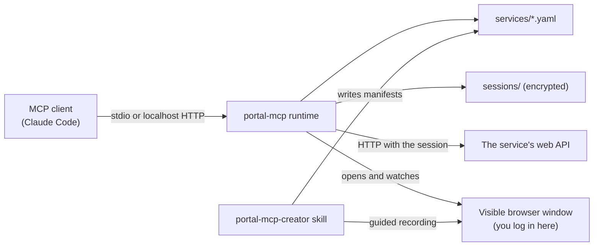
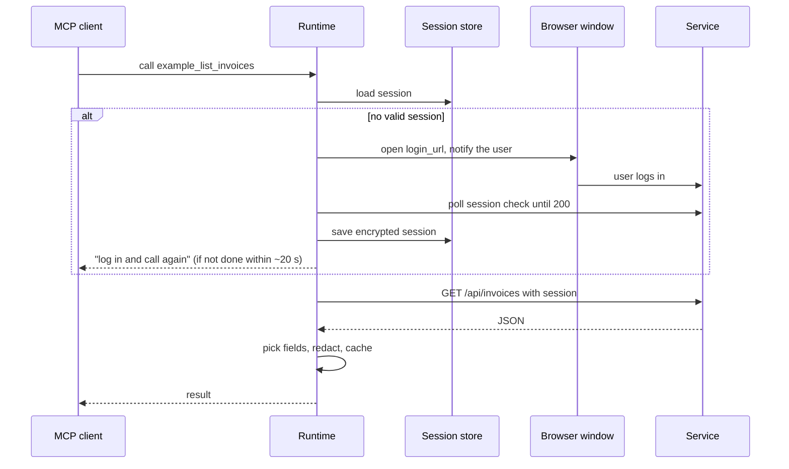
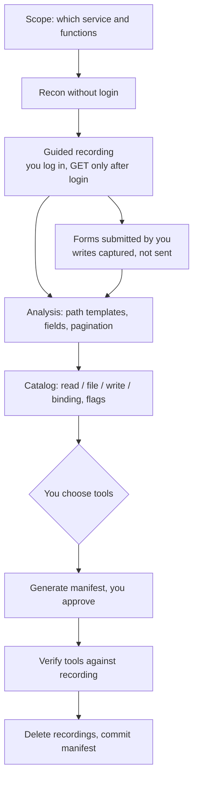
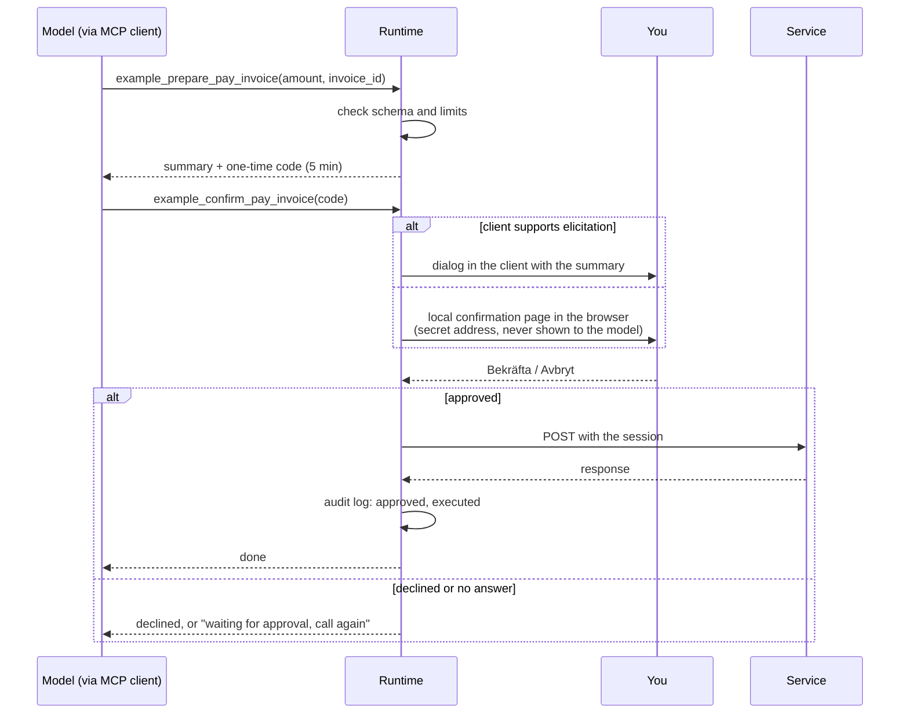

# portal-mcp

Create MCP tools for logged-in web services and customer portals that have no open API.

- You log in yourself, in a visible browser window. The runtime never reads or stores your password.
- Each service is described by a YAML manifest. The runtime turns the manifest into MCP tools.
- Sessions are stored encrypted. The encryption key lives in your system keyring.
- Write actions run in two steps and only after you approve them yourself, in a dialog or a local confirmation page. The model cannot approve its own actions.
- Every write action is logged in a local audit log.

**Status: phase 3.** The runtime, the `local` login provider, encrypted session storage, read, file, write and binding tools, the `portal-mcp-creator` skill and a local mock service with tests are in place. `self_test`, several profiles per service in the skill flow, the slash commands and plugin installation checks come in phase 4.

## Requirements

- A computer with a graphical desktop: macOS, Windows, or Linux with a desktop environment.
- [`uv`](https://docs.astral.sh/uv/) to run the runtime.
- Google Chrome (preferred), or Playwright's Chromium: `uv run playwright install chromium`.

## Install as a private plugin

```text
/plugin marketplace add markstrom/portal-mcp
/plugin install portal-mcp@portal-mcp
```

## How it fits together



The skill creates manifests. The runtime turns them into tools. The browser is only used for logging in and recording, and you control the login.

## Login and a tool call



## Creating a service (skill pipeline)



## Write actions and approval



The summary you approve is built by the runtime from the real values, not written by the model. Codes are one-time and expire after five minutes. Limits are checked when the action is prepared and again when it is confirmed.

## Where your data lives

Data is kept outside the plugin, so updates never remove it. The location follows your OS conventions (`platformdirs`):

```text
<user data dir>/portal-mcp/
  services/<service>.yaml     manifests
  profiles/<service>/<profile>/  browser profiles
  sessions/                   encrypted sessions
  recordings/                 temporary recordings, deleted after a manifest is written
  audit.log                   every write action: time, service, tool, call and response
```

Set `PORTAL_MCP_HOME` to use another base directory. Downloaded files go to your Downloads folder, or to `PORTAL_MCP_DOWNLOADS` if set.

## Manifest

One file per service, `services/<name>.yaml`. The file name must match `name`. A broken manifest only affects its own service.

```yaml
name: example
enabled: true
base_url: https://app.example.com
login_url: https://app.example.com/login
profiles: [default]
session:
  type: cookies               # cookies | bearer
  bearer_source: null         # for bearer: "localStorage:<key>" or "sessionStorage:<key>"
  csrf:
    header: x-csrf-token
    from_cookie: csrf
  check: /api/session         # 200 = logged in, 401 = not logged in
  logout: /api/logout         # optional, called with POST
rate_limit_per_minute: 30
cache_seconds: 30             # caches read results
redact: [items.owner.national_id]
tools:
  - name: list_invoices
    kind: read                # read | file | write | binding
    description: List invoices with date, amount and status.
    method: GET
    path: /api/invoices
    params:
      type: object
      properties:
        page: {type: integer}
    pick: [items.id, items.date, items.amount, items.status]
  - name: download_invoice_pdf
    kind: file
    description: Download the PDF for one invoice.
    method: GET
    path: /api/invoices/{invoice_id}/pdf
    params:
      type: object
      properties:
        invoice_id: {type: string}
      required: [invoice_id]
  - name: pay_invoice
    kind: binding             # binding: payments, bids, orders, signatures
    description: Pay an invoice.
    method: POST
    path: /api/invoices/{invoice_id}/pay
    params:
      type: object
      properties:
        invoice_id: {type: string}
      required: [invoice_id]
    body_encoding: json       # json | form
    body_schema:
      type: object
      properties:
        amount: {type: number}
      required: [amount]
    body_constants: {}        # fixed body fields, for example hidden form inputs
    limits:                   # required for binding tools
      max: {amount: 5000}     # also: min, allowed (list of values), max_length
    summary: "Pay {amount} for invoice {invoice_id}"
  - name: send_message
    kind: write
    messaging: true           # sends free text to other people: off by default
    enabled: true             # needed to turn a messaging tool on
    method: POST
    path: /api/messages
    body_schema:
      type: object
      properties:
        to: {type: string}
        text: {type: string}
      required: [to, text]
```

Read and file tools are prefixed with the service name, for example `example_list_invoices`. Write and binding tools become `example_prepare_pay_invoice` and `example_confirm_pay_invoice`. Every tool except `confirm_` also takes an optional `profile` argument.

Common tools: `list_services`, `forget_session(service)`, `logout(service)`.

### Logging in

When a tool needs a session and none is valid, a browser window opens on `login_url` and a desktop notification asks you to log in. The runtime checks the session check endpoint and captures the session once you are logged in. A tool call waits up to about 20 seconds; if you are not done by then, it tells you to finish in the window and call again. The login continues in the background. Only one login runs at a time.

## Development

```bash
uv sync
uv run pytest
```

The tests run against `tests/mock_service/`, a local fake portal with invented data. Tests that need a browser are skipped if neither Google Chrome nor Playwright's Chromium is installed.

Run the server directly:

```bash
uv run portal-mcp-runtime            # stdio (default)
uv run portal-mcp-runtime --http     # streamable HTTP at http://127.0.0.1:8765/mcp
```

Logs go to stderr only.

## Security notes

- Passwords are never handled by this software. Logging in happens in a window you can see.
- Session files are encrypted with a key stored in the system keyring and have mode 0600.
- The HTTP transport only binds to localhost.
- Read results can be trimmed with `pick` and `redact` before they reach the model.
- Write actions need a person's approval through MCP elicitation or a local confirmation page. The page is served on 127.0.0.1, its address carries a secret token that the model never sees, and it only accepts clicks from its own origin.
- Tools that send free text to other people are off unless the manifest turns them on.
- During recording, writes are stopped in the browser and only their format is saved, unless you explicitly agree to a real action.
- Set `PORTAL_MCP_APPROVAL=browser` to always use the confirmation page, even if the client supports elicitation.
